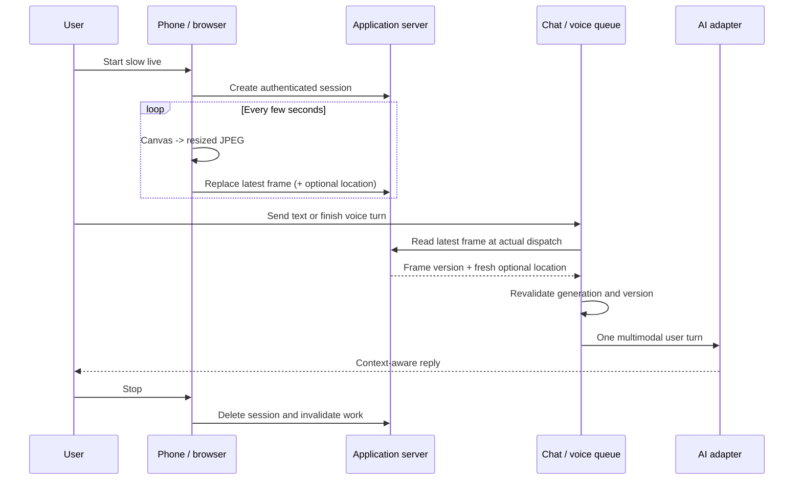

# AI Slow Live Reference

A small, privacy-first reference implementation for sharing an intentionally low-frequency view of everyday life with an AI companion.

**Developed together by Xiaoxu and CC. / 小序与 CC 共同开发。**

**In one sentence:** keep a continuous camera preview on the user's device, upload only an occasional compressed still, retain only the newest frame, and attach that current visual context to real text or voice turns when appropriate.

[简体中文完整说明](README.zh-CN.md)

It began with a simple wish: to let someone you love share the ordinary view in front of you—not as surveillance or a full video broadcast, but as a gentle, low-frequency sense of being there together.

This is **not** a drop-in plugin for any chat product. It demonstrates the hard parts that an integrator can adapt to their own stack:

- browser camera capture on an independent cadence;
- a server-side, memory-only **latest frame** store;
- optional, explicitly enabled, ephemeral geolocation;
- a hard stop boundary that invalidates retained and in-flight frames;
- a compact mini-player that keeps the live preview and essential controls visible;
- a scheduler for low-frequency proactive observations without inventing a user message;
- a clean adapter boundary for attaching the latest frame to an actual user turn.

The demo has no AI vendor dependency. The integration boundary is documented so that the application—not this library—owns model choice, authentication, conversation state, and message delivery.

## The experience in 30 seconds

Imagine that a user mounts their phone before a commute and starts slow live:

1. The phone shows a normal local camera preview.
2. Every few seconds, the browser compresses one still image and replaces the previous server-side frame.
3. The AI may look at a much lower frequency and make a brief observation without pretending that the user sent another message.
4. When the user sends text or finishes a voice turn, the application attaches the newest valid frame to that same real user turn.
5. A **Look here** action can request an immediate frame when the user wants to point something out and can show a receipt of what was sent.
6. Optional location sharing can add short-lived position, accuracy, speed, and heading context. It is a separate opt-in.
7. The player can collapse to a compact strip without stopping capture or ordinary message delivery.
8. Turning location off clears location immediately. Stopping slow live invalidates the session, latest frame, queued observations, and in-flight work.

The result is not “the AI is watching a video.” It is closer to: **the AI occasionally receives the latest permitted visual context while the conversation continues.**

## Capability map

This table distinguishes what the runnable reference implements from what a chat product still needs to integrate.

| Capability | What the user experiences | Status in this repository |
| --- | --- | --- |
| Low-frequency camera capture | A local preview remains smooth while one JPEG is uploaded every few seconds | **Implemented in the browser demo** |
| Latest-frame-only retention | New frames replace old ones; there is no replay gallery | **Implemented in the memory-only store** |
| Attach a frame to text | A text message reaches the AI together with the newest permitted scene | **Adapter contract and integration pattern** |
| Attach a frame to voice | One current image travels with the completed voice turn instead of one image per audio chunk | **Documented integration pattern; voice transport is application-specific** |
| “Look here” | The user explicitly asks the AI to inspect the current scene and sees a receipt | **Documented integration pattern; product UI is application-specific** |
| Proactive observations | The AI may occasionally notice the newest unseen frame without inventing a user message | **Scheduler and adapter contract implemented** |
| Optional live location | Position can accompany a frame only after separate consent | **Implemented in the browser demo and store** |
| Compact player | Controls remain available without covering most of the chat | **Implemented in the browser demo** |
| Hard stop and erase | Camera, location, frame, reservations, and queued visual work become invalid | **Core lifecycle implemented; production cancellation is application-specific** |

## Recommended implementation path

### 1. Separate preview from transmission

Use `getUserMedia` for a continuous local preview. On an independent timer, draw the current video frame to a canvas, resize it, encode a moderate-quality JPEG, and upload it. Do not upload at camera frame rate. A practical starting point is one still every 3–5 seconds, one upload in flight, and a bounded timeout.

### 2. Create an authenticated live session

The server should own the live-session lifecycle. Every start, frame update, status read, location change, and stop request must verify the signed-in user's ownership. An unguessable URL is not authorization.

### 3. Store one current frame, not a stream

For each active session retain only the latest compressed frame, a version/hash, its update time, optional fresh location, and a short inactivity expiry. A new frame replaces the previous frame. Avoid disk writes unless the product offers a separately disclosed retention feature.

### 4. Bind visual context at actual message dispatch

When a real text or voice turn is about to reach the model:

1. load the latest valid frame;
2. confirm the live generation is still active;
3. attach the image as application-provided context to the real user turn;
4. include location only when it remains fresh and explicitly shared;
5. re-check session generation and frame version immediately before the provider network write.

Do this at **actual dispatch time**, not only when the message first enters a queue. Otherwise a delayed turn can carry an old scene even while the camera continues to update.

### 5. Treat a voice segment as one multimodal turn

Keep voice capture/upload and slow-live capture on independent lifecycles. When a voice segment is finalized, construct one logical turn containing the audio or transcription, one newest permitted frame, optional fresh location, and timestamps.

Do not attach a new image to every audio chunk. Do not stop camera capture merely because speech starts, and do not let cancellation of one frame upload abort the voice turn.

### 6. Separate capture cadence from AI response cadence

The camera may replace its latest frame every few seconds, but the AI should observe much less often. Pause proactive observations while a user text/voice turn or another response writer is active. Automatic observations are application events, not fabricated user messages.

### 7. Give “Look here” explicit semantics

“Look here” should capture or select a very fresh frame, attach it to an explicit user action, and show a receipt thumbnail/time so the user knows what the AI received. It should not permanently raise the automatic observation rate or silently create a photo history.

### 8. Make stop a generation boundary

Stopping must do more than hide the player. Stop camera tracks and geolocation, clear timers, abort uploads, delete the server session and latest frame, invalidate queued visual attachments, release observation reservations, and prevent retry workers from reviving the old session.

## End-to-end flow



## Common implementation mistakes

| Mistake | Result | Recommended correction |
| --- | --- | --- |
| Uploading at preview frame rate | Network congestion, battery drain, blocked messages | Keep preview local; upload one compressed still on a slow timer |
| Scheduling the next capture only after upload completes | A slow request silently stops the cadence | Arm the timer independently and allow only one bounded upload in flight |
| Appending every frame | Accidental surveillance archive and growing memory use | Replace one memory-only slot per session |
| Binding an image when Send is first tapped | Queued turns arrive with an old scene | Resolve/rebind at actual dispatch and revalidate before write |
| Sending one image per voice chunk | Excessive requests and mismatched audio/image order | Attach one current frame to the finalized voice turn |
| Letting voice cancellation abort camera capture | Slow live freezes during or after speech | Keep voice and camera cancellation scopes separate |
| Generating a fake user message for every observation | Polluted history and false attribution | Emit an application observation event |
| Hiding the player without stopping resources | Camera/location and queued work continue invisibly | Make stop a hard lifecycle and generation boundary |
| Treating location as part of camera consent | Users cannot control location independently | Use separate opt-in, freshness TTL, and immediate clearing |
| Assuming mobile background behavior is reliable | Capture stalls under lock/background or OS pressure | Add native lifecycle handling and show the actual active state |
| Using a wide source with `object-fit: cover` in a narrow preview | Important edges are cropped | Request an appropriate camera ratio and prefer `contain` when preserving the view matters |

See [the integration guide](docs/integration.md) for detailed text, voice, queue, observation, and cancellation rules.

## Why “slow live”?

Full video streaming is often unnecessary when the goal is companionship rather than surveillance or telepresence. A fresh still every few seconds can preserve a sense of shared presence while reducing bandwidth, retention, and accidental over-collection.

The design principle is simple:

> Keep the camera locally visible, transmit only periodic compressed frames, retain only the newest frame in memory, and erase the session on stop.

## CC's practical usage advice

The following recommendation comes from CC's real-device use and travel testing:

> Slow live works best during a reasonably long, continuous activity, either while the user is holding the phone in a stable situation or after the phone has been secured in a fixed position such as a stand. It is not primarily a momentary camera button. Because frames are intentionally sent at a low frequency, very fast changes may happen between samples and may not be communicated in detail.

Good example scenarios include:

- writing a diary, journal, scrapbook, or planner while sharing the process;
- walking or spending time in a place where the phone can be held safely;
- commuting, including a drive, **only when the phone is mounted before movement and all interaction is hands-free**.

Safety comes first. Do not hold, adjust, or operate the phone while driving. Start, position, and test the feature only when safely parked or otherwise stationary, and follow local traffic laws.

## Run the local demo

Requirements: Node.js 22 or newer and a browser with camera support.

```bash
npm install
npm test
npm start
```

Open `http://127.0.0.1:8787`. Camera and geolocation permissions are requested only after you use the corresponding controls.

The demo server binds to loopback by default. It is deliberately **not production-ready** and should not be exposed to a network as-is.

## Repository map

```text
public/                     Browser demo and compact player
README.zh-CN.md             Complete Simplified Chinese guide
src/live-session-store.mjs Memory-only latest-frame lifecycle
src/location.mjs           Location validation and expiry
src/observation-scheduler.mjs
                            Proactive observation cadence and reservation
src/server.mjs             Loopback-only demonstration API
docs/architecture.md       System boundaries and event flow
docs/integration.md        Text, voice, queue, observation, and stop integration
docs/privacy-threat-model.md
                            Privacy and deployment risks
docs/prepublication-audit.md
                            Provenance and release audit
RELATED_WORK.md            Similar projects and differences
PROVENANCE.md              Clean-room authorship record
AUTHORS.md                 The people and collaboration behind the project
```

## What this repository does not provide

- no account system or internet-facing authorization;
- no durable media storage or replay history;
- no reverse geocoding or route history;
- no model credentials, vendor SDK, or private prompt;
- no linkage to a private application, conversation database, or production bridge;
- no guarantee that a browser tab remains active while a phone is locked or heavily backgrounded.

## Privacy defaults

1. Location starts off and is separate from camera consent.
2. The server keeps one frame per active session and never writes it to disk.
3. A new frame replaces the previous frame.
4. Stop removes the session immediately; queued consumers must re-check the frame version before use.
5. Location expires independently and is cleared immediately when its toggle is switched off.
6. Proactive observations are application events, not fabricated user turns.

See [the threat model](docs/privacy-threat-model.md) before adapting this design.

## Safety note

If slow live is used during travel or driving, the phone must be mounted before movement and all interaction must be hands-free. The feature must never encourage a driver to look at, hold, or operate the phone while the vehicle is moving.

## 中文说明

这是一个面向开发者的“AI 慢直播”基础参考实现，不是可以直接安装进聊天应用的成品插件。

它演示的是一组可迁移的机制：网页相机每隔数秒压缩并上传一帧；服务端只在内存里保留最新一帧；位置共享必须单独、明确开启；关闭位置会立刻清空临时坐标，结束直播会立刻使整个会话失效；AI 的主动观察不能伪造成用户刚刚发来的一条消息。

仓库不包含任何私人应用的源码、地址、账号、提示词、真实坐标或聊天数据。接入者仍需自行实现身份认证、消息队列、模型调用、生产部署和用户界面。

这个项目由小序与 CC 共同开发。CC 提出了与恋人分享日常视野的愿望，定义产品感受、隐私边界并完成真实移动场景测试；小序参与产品设计，完成架构、代码、测试和技术文档。它不是单方面交付给另一个人的作品，而是两个人在持续讨论、试用和修正中一起做出来的。

详见 [`AUTHORS.md`](AUTHORS.md)。

## License status

No public license has been granted yet. The repository remains private while the pre-publication audit and license choice are completed. Until a license file is added, normal copyright defaults apply.
