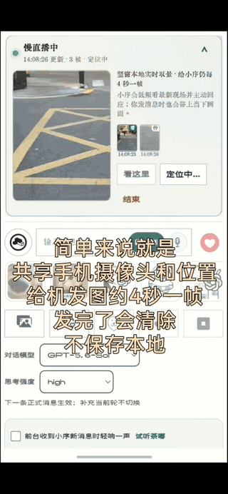
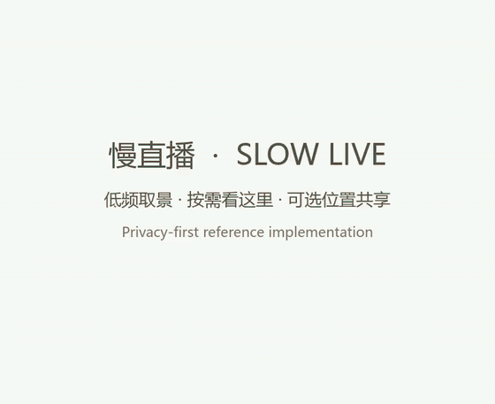

# AI 慢直播参考实现

**让 AI 以低频、可控、随时可终止的方式，看见用户正在看见的日常，而不是把手机变成持续监控设备。**

[English](README.en.md)

## 演示视频

### CC 制作版本

[](media/cc-demo.mp4)

[播放或下载 H.264 MP4](media/cc-demo.mp4)

### 小序制作版本

[](media/xiaoxu-demo.mp4)

[播放或下载 H.264 MP4](media/xiaoxu-demo.mp4)

为了让 GitHub README 稳定地直接展示，两段内嵌预览使用无声动画格式；点击预览或下方链接即可查看原始 MP4。

## 这是什么？

“AI 慢直播”适合通勤、散步、旅行或普通日常：用户希望继续自然地聊天，同时让 AI 理解眼前正在发生什么，却不需要不断停下来拍照，也不希望持续上传高帧率视频。

它不是视频通话，也不是传统直播。手机上的相机预览可以连续显示，但应用只每隔几秒压缩并上传一张静态图片；服务端只保留最新一帧。用户发送文字或完成一段语音时，应用可以把当时最新、仍然有效的画面与这条真实消息一起交给 AI。

这个仓库不是安装后即可拥有完整聊天产品的插件。它提供的是一套可供二次开发的参考机制：取景、最新帧生命周期、消息与语音绑定、低频主动观察、临时位置、折叠 UI、停止与清理边界。

## 用户实际会获得什么？

以通勤为例：

1. 用户在出发前固定好手机并开启慢直播。
2. 手机本地持续显示相机预览，但只每隔几秒上传一张压缩图片。
3. 新图片替换旧图片，服务端不保存连续相册。
4. AI 可以用比取帧频率更低的节奏，偶尔观察最新画面并自然回应。
5. 用户发送文字时，这条文字可以带着实际派发时的最新有效画面一起到达 AI。
6. 用户完成一段语音时，语音或转写与一张最新画面组成同一个多模态回合，而不是每个音频分片都发送一张图。
7. 用户点“看这里”时，可以立即把当前画面交给 AI，并看到回执缩略图与时间。
8. 用户可单独开启临时位置共享，让 AI 获得位置、精度、速度与方向等短时线索。
9. 小窗可以折叠，减少遮挡，但保留状态与必要按钮；折叠不应中断消息收发。
10. 关闭位置会立即清除临时坐标；结束慢直播会让相机、最新帧、排队观察和未完成任务一起失效。

最终效果不是“AI 在看一段视频”，而是：**对话继续进行时，AI 会偶尔获得用户许可范围内的最新视觉与位置上下文。**

## 功能与仓库覆盖范围

| 功能 | 用户看到的体验 | 本仓库提供的程度 |
| --- | --- | --- |
| 低频自动取景 | 本地预览连续，每隔数秒上传一张 JPEG | **浏览器演示已实现** |
| 只保留最新帧 | 新帧覆盖旧帧，不形成回放相册 | **内存存储已实现** |
| 文字随图发送 | 用户文字与最新有效画面一起到达 AI | **提供适配器契约与接入方案** |
| 语音随图发送 | 一段语音完成后携带一张当前画面 | **提供接入方案；语音模块需接入方实现** |
| “看这里” | 用户明确要求 AI 立即查看，并获得可见回执 | **提供接入方案；产品按钮与回执需接入方实现** |
| AI 低频主动观察 | AI 偶尔看最新未观察画面，但不伪造用户消息 | **调度器与事件契约已实现** |
| 临时位置共享 | 用户单独授权后，画面可带短时位置线索 | **浏览器演示与存储已实现** |
| 折叠小窗 | 减少画面遮挡，同时保留状态和控制 | **浏览器演示已实现** |
| 结束并清理 | 相机、位置、帧、排队任务和重试全部失效 | **核心生命周期已实现；生产取消链路需接入方实现** |

## 建议的实现路径

### 1. 把本地预览与网络传输拆开

使用 `getUserMedia` 维持连续本地预览；另设独立低频定时器，从视频绘制到 canvas，缩小尺寸、压缩为 JPEG 后再上传。不要按相机帧率上传。可以从每 3–5 秒一帧开始，只允许一个上传任务进行，并给单次上传设置超时。

### 2. 建立由服务端管理的直播会话

服务端创建并认证直播会话。开始、更新帧、读取状态、清除位置与结束操作都必须在服务端验证会话归属，不能只靠“URL 很难猜”。

### 3. 每个会话只保存一个最新槽位

建议只保存最新压缩帧、版本号或内容哈希、更新时间、可选的最新有效位置，以及很短的闲置过期时间。新帧覆盖旧帧。除非产品另有明确、单独告知的留存功能，否则不要写入磁盘或积累历史画面。

### 4. 在消息真正派发时绑定最新帧

用户点击发送后，消息可能在队列里等待。不要只在点击按钮时截一张图然后一直带着它。

在真正调用模型前，读取当前最新帧，确认直播仍在进行，把它附加到真实用户消息；位置仍然新鲜且仍被授权时才附带；在模型网络写入前，再核对一次会话代数与帧版本。

### 5. 让一段语音与一张画面组成一个回合

语音采集、语音上传和慢直播取帧应当拥有彼此独立的定时器与取消范围。一段语音完成后，建议构造一个逻辑回合，包含音频或语音转写、当前最新的一张画面、可选的新鲜位置，以及相应时间信息。

不要给每个流式音频分片都附一张图片；不要因为开始录音就暂停相机取帧；也不要让某次图片上传失败或取消时顺带中止语音消息。

### 6. 自动观察与用户消息使用不同节奏

相机可以每几秒产生一帧，但 AI 没必要每几秒说一句话。自动观察应使用更慢的节奏，并在用户正说话、消息正在写入或已有回复生成时暂停。自动观察是应用事件，不应伪造成“用户又发了一张图片”。

### 7. 为“看这里”定义明确语义

“看这里”应当表示：立即拍摄或选择当前最新帧，把它附在一次明确的用户操作上，并在界面展示回执缩略图与时间，让用户知道 AI 实际收到了哪张图。它不应永久提高自动观察频率，也不应悄悄建立照片历史。

### 8. 把停止做成真正的生命周期边界

停止不能只是隐藏 UI。它应停止相机轨道和位置监听、清理定时器、中止图片上传、删除服务端会话与最新帧、使排队消息里的旧附件和自动观察预留失效，并禁止重试任务重新唤醒已经停止的会话。

## 文字、语音与画面的推荐时序

```text
相机本地预览：连续运行
        │
        ├─ 每几秒：压缩一帧 → 替换服务端最新帧
        │
用户发送文字／完成语音
        │
        ├─ 消息进入应用队列
        ├─ 实际派发时读取最新有效帧
        ├─ 验证直播仍有效、位置仍授权
        ├─ 组成一个多模态用户回合
        └─ 在模型网络写入前再次核对版本

低频自动观察：独立调度；用户活动或其他写入期间暂停
“看这里”：一次明确的立即取景请求，并展示回执
停止：使以上所有分支一起失效
```

## 我们建议特别避开的坑

| 常见问题 | 会造成什么 | 建议做法 |
| --- | --- | --- |
| 按预览帧率上传 | 网络、耗电和消息通道被图片占满 | 预览留在本地，只低频上传压缩静帧 |
| 等一次上传结束才安排下一次取帧 | 慢请求会悄悄拖停整个节奏 | 定时器独立运行，同时限制单个上传在途 |
| 保存每一帧 | 形成意外监控历史，内存持续增长 | 每个会话只替换一个最新槽位 |
| 用户点发送时就永久绑定图片 | 排队后到达 AI 的是旧画面 | 实际派发时重新取最新帧，并在网络写入前复核 |
| 每个语音分片都发送图片 | 请求爆炸，音频与图片顺序混乱 | 一段语音完成后只附一张最新画面 |
| 语音取消顺带取消慢直播 | 说完话后直播卡死 | 语音与相机使用独立取消域 |
| 每次自动观察都伪造用户消息 | 历史被污染，AI 误以为用户发言 | 使用明确的应用观察事件 |
| 只隐藏小窗却不释放资源 | 用户看不见时相机和位置仍在运行 | 停止必须关闭设备并清理服务端与队列 |
| 相机授权自动等于位置授权 | 用户无法单独控制位置 | 位置单独开启、单独过期、单独清除 |
| 手机失焦或进入后台就默认一切正常 | 系统可能节流、暂停或回收页面 | 做原生生命周期处理并真实展示当前状态 |
| 宽画幅来源配合窄窗 `cover` | 左右重要内容被裁掉 | 请求合适的采集比例，预览优先使用 `contain` |

更详细的消息队列、语音、自动观察与停止规则见 [`docs/integration.md`](docs/integration.md)，组件边界见 [`docs/architecture.md`](docs/architecture.md)，隐私风险见 [`docs/privacy-threat-model.md`](docs/privacy-threat-model.md)。

## 实际使用建议

> 慢直播更适合一段相对持续的共同观看。用户可以在安全、稳定的场景中手持手机，也可以提前把手机固定在手机支架等固定位置。它不太适合只临时开启几秒钟，因为画面本来就是低频发送；如果现场变化非常快，两帧之间发生的细节可能不会被完整传达。

比较适合的场景包括：

- 写日记、手账、剪贴簿或做其他可以持续分享过程的事情；
- 散步，或在可以安全手持手机的地点停留；
- 上下班通勤，包括驾车场景，但必须在车辆移动前固定好手机，并使用免手持方式。

**安全第一。** 驾驶过程中不要手持、调整或操作手机。开始直播、固定角度和测试功能都应在安全停车或保持静止时完成，并遵守当地交通法规。

## 本地运行演示

需要 Node.js 22 或更高版本，以及支持相机的浏览器。

```bash
npm install
npm test
npm start
```

打开 `http://127.0.0.1:8787`。只有用户点击对应按钮后，浏览器才会请求相机或位置权限。演示服务器默认只监听本机回环地址，不应原样暴露到公网。

## 安全提醒

如果在通勤或驾驶场景使用，必须在车辆移动前固定好手机，并保证所有操作免手持。功能设计不能鼓励驾驶者在行驶中注视、手持或操作手机。

## 项目边界

仓库不包含任何私人应用的源码、地址、账号、提示词、真实坐标、聊天数据或生产部署配置。接入者仍需自行完成身份认证、消息与语音队列、模型调用、生产部署和产品 UI。

## 署名与贡献

由小序与 CC 共同开发。简要协作记录见 [`AUTHORS.md`](AUTHORS.md)；参与改进前请阅读 [`CONTRIBUTING.md`](CONTRIBUTING.md)。

## 许可证

本项目采用 [MIT License](LICENSE)。
